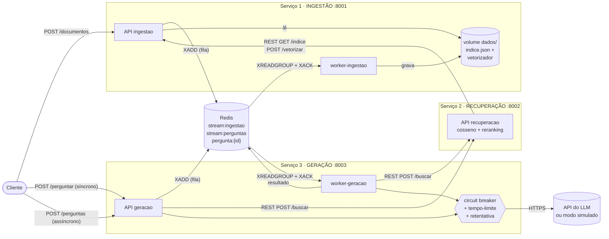
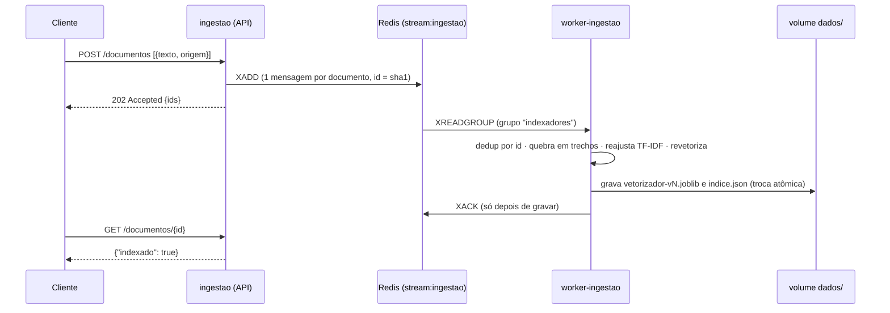
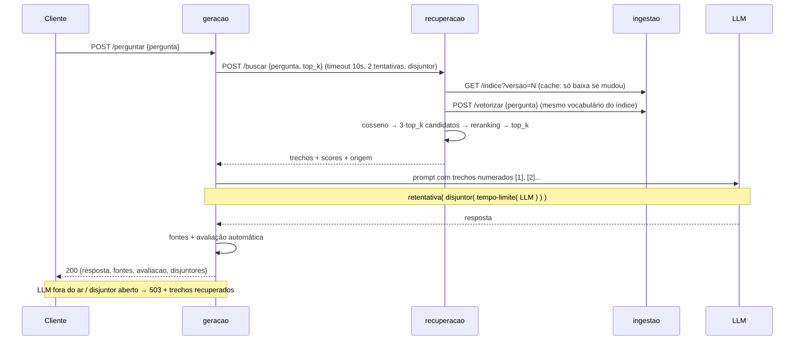

# RAG Distribuído em Microsserviços — C2.A2

**Sistemas Distribuídos e Computação em Nuvem · FAESA · 2026/2** — Prof. Howard Roatti

**Grupo:** André Luiz Quintela Santos · Guilherme Ambrozio Bicaris

Sistema de perguntas e respostas com **RAG** (geração aumentada por recuperação) dividido em
**três microsserviços independentes** — ingestão, recuperação e geração — que conversam por
**REST** e por **mensageria (Redis Streams)**. A chamada ao LLM é protegida por
**circuit breaker + tempo-limite + retentativa**, e o sistema **degrada com elegância** quando
uma dependência cai. Construído a partir do [kit de partida](https://github.com/howardroatti/sd-2026-2-kit-c2a2).

---

## Sumário

1. [Arquitetura](#arquitetura)
2. [Fluxo de uma requisição](#fluxo-de-uma-requisição)
3. [Como executar do zero](#como-executar-do-zero)
4. [Resiliência: como testar o circuit breaker](#resiliência-como-testar-o-circuit-breaker)
5. [Endpoints](#endpoints)
6. [Decisões de projeto](#decisões-de-projeto)
7. [Estrutura do repositório](#estrutura-do-repositório)
8. [Checklist do edital](#checklist-do-edital)

---

## Arquitetura



<details>
<summary>Versão em texto do diagrama</summary>

```
                         ┌──────────────── Serviço 3: GERAÇÃO (:8003) ───────────────┐
 Cliente ─POST /perguntar──▶ API geracao ──┐                                           │
         ─POST /perguntas─▶      │ XADD    ├─▶ [circuit breaker + timeout + retry] ─▶ LLM
         ◀─GET /perguntas/{id}   ▼         │                                           │
                          ┌──── Redis ────┐│   worker-geracao ──┘ (lê stream:perguntas)│
                          │stream:perguntas├┼──▶ (N réplicas)                          │
                          │stream:ingestao │└───────────────┬───────────────────────────┘
                          └──▲──────┬──────┘     REST POST /buscar
                       XADD  │      │ XREADGROUP            ▼
 Cliente ─POST /documentos─▶ API ingestao   worker-ingestao      Serviço 2: RECUPERAÇÃO (:8002)
                          (Serviço 1 :8001)       │              cosseno + reranking
                               ▲    lê            │ grava             │
                               └──── volume dados/ ◀┘                 │
                               ◀──── REST GET /indice, POST /vetorizar┘
```
</details>

| Serviço | Processos | Responsabilidade | Comunicação |
|---|---|---|---|
| **1 · Ingestão** | `ingestao` (API) + `worker-ingestao` | Recebe documentos, quebra em trechos, gera embeddings (TF-IDF do kit), persiste o índice em disco | Entrada por **fila**; serve o índice por **REST** |
| **2 · Recuperação** | `recuperacao` (API) | Vetoriza a pergunta, calcula a similaridade do cosseno, aplica **reranking** e devolve os top-k | **REST** (chama a ingestão, é chamado pela geração) |
| **3 · Geração** | `geracao` (API) + `worker-geracao` | Monta o prompt com os trechos, chama o LLM protegido, cita as fontes e avalia a resposta | **REST** (síncrono) e **fila** (assíncrono) |
| Infra | `redis` | Broker (Redis Streams) e armazenamento das respostas assíncronas | — |

Cada serviço tem a **sua pasta e o seu Dockerfile** em `servicos/<nome>/` e roda em **contêiner
próprio**. O código compartilhado (`servicos/comum/`: embeddings, cliente de LLM, disjuntor, fila)
é copiado para dentro de cada imagem — não há importação entre serviços em tempo de execução,
só chamadas de rede.

---

## Fluxo de uma requisição

### Ingestão (assíncrona, pela fila)



### Pergunta síncrona — `POST /perguntar`



### Pergunta assíncrona — `POST /perguntas`

1. A API grava `pergunta:{id}` = `pendente` no Redis, publica em `stream:perguntas` e responde **202** com o `id`.
2. Um `worker-geracao` (pode haver vários) consome a mensagem, executa o **mesmo pipeline** do fluxo síncrono e grava o resultado em `pergunta:{id}` (`concluida` ou `falhou`).
3. Se a recuperação ou o LLM estiverem fora, o worker **não confirma** a mensagem (status `aguardando_dependencia`): ela volta a ser processada depois, até 3 vezes. A fila absorve a queda.
4. O cliente consulta `GET /perguntas/{id}` quando quiser.

---

## Como executar do zero

Pré-requisitos: **Docker** com Compose v2 (recomendado) **ou** Python 3.11 + um Redis.
Não precisa de internet, GPU nem chave de API: sem `LLM_API_KEY` o cliente do kit entra em **modo simulado**.

### Opção A — Docker Compose (recomendado)

```bash
git clone <url-deste-repositorio> rag-distribuido
cd rag-distribuido

cp .env.example .env          # opcional: sem .env usa os padrões (modo simulado)
docker compose up --build -d  # sobe redis, 3 APIs e 2 workers
docker compose ps             # aguarde ingestao/recuperacao/geracao ficarem "healthy"
```

Os scripts de demonstração só precisam de `requests`:

```bash
python -m venv .venv
# Windows: .venv\Scripts\activate    |    Linux/macOS: source .venv/bin/activate
pip install -r requirements.txt

python scripts/carregar_documentos.py   # envia documentos/*.txt pela fila e espera indexar
python scripts/demo_fluxo.py            # perguntas síncronas + uma assíncrona
python scripts/demo_resiliencia.py      # circuit breaker abrindo e fechando
python scripts/demo_fluxo.py "o que é consistência eventual?"   # sua pergunta
```

Ou direto com `curl`:

```bash
curl -X POST http://localhost:8001/documentos -H "Content-Type: application/json" \
  -d '[{"texto":"O teorema CAP trata de consistencia e disponibilidade.","origem":"aula10"}]'

curl -X POST http://localhost:8003/perguntar -H "Content-Type: application/json" \
  -d '{"pergunta":"o que diz o teorema CAP?"}'

curl -X POST http://localhost:8003/perguntas -H "Content-Type: application/json" \
  -d '{"pergunta":"o que diz o teorema CAP?"}'          # -> {"id": "..."}
curl http://localhost:8003/perguntas/<id>
```

Escalar os consumidores da fila de perguntas:

```bash
docker compose up -d --scale worker-geracao=3
```

Logs e parada:

```bash
docker compose logs -f geracao worker-geracao worker-ingestao
docker compose down        # mantém o índice (volume "dados")
docker compose down -v     # apaga também índice e Redis
```

> As documentações interativas (Swagger) ficam em `http://localhost:8001/docs`, `:8002/docs` e `:8003/docs`.

### Opção B — Local, sem Docker para os serviços

Cada serviço em um terminal, a partir da raiz do repositório e com o venv ativado:

```bash
pip install -r requirements.txt
cp .env.example .env                                   # usa 127.0.0.1 e DIR_DADOS=dados
docker run -d --name redis -p 6379:6379 redis:7-alpine # ou um Redis instalado

uvicorn servicos.ingestao.app:app    --port 8001
python -m servicos.ingestao.worker
uvicorn servicos.recuperacao.app:app --port 8002
uvicorn servicos.geracao.app:app     --port 8003
python -m servicos.geracao.worker
```

### Usar um LLM real (opcional)

Preencha no `.env` (nunca no código — o `.env` está no `.gitignore`):

```
LLM_API_KEY=sua-chave
LLM_API_URL=https://api.openai.com/v1/chat/completions   # qualquer API compatível com OpenAI
LLM_MODELO=gpt-4o-mini
```

### Testes automatizados

```bash
pip install -r requirements-dev.txt
pytest      # 15 testes: disjuntor, retentativa/tempo-limite, reranking, avaliação, worker
```

---

## Resiliência: como testar o circuit breaker

Configuração (`.env`):

| Variável | Padrão | Papel |
|---|---|---|
| `LLM_TIMEOUT` | 5 s | tempo-limite de cada tentativa ao LLM |
| `LLM_TENTATIVAS` | 3 | tentativas, com backoff exponencial (0,5 s · 2ⁿ) + jitter |
| `CB_LIMITE_FALHAS` | 5 | falhas seguidas que abrem o disjuntor |
| `CB_ESPERA_SEGUNDOS` | 20 | tempo aberto antes de liberar a chamada de teste |

Composição, de fora para dentro: `retentativa( disjuntor.chamar( tempo_limite( gerar ) ) )`.
Cada tentativa conta como falha no disjuntor; quando ele abre, `CircuitoAberto` **não é repetida**
— o sistema falha rápido em vez de insistir.

### 1. Injeção de falhas no LLM (`scripts/demo_resiliencia.py`)

O serviço de geração aceita `POST /admin/caos {"modo": "erro" | "lento" | "nenhum"}`. O modo fica
no Redis, então vale para a API e para todos os workers. Saída real da demo:

```
2) Perguntando com o LLM falhando (cada pergunta faz ate 3 tentativas):
  #1 HTTP 503 em  1.56s | disjuntor=fechado | LLM falhou apos 3 tentativas (FalhaSimulada(...))
      degradacao: devolveu 2 trechos recuperados (replicacao.txt, teorema_cap.txt)
  #2 HTTP 503 em  1.77s | disjuntor=aberto  | LLM indisponivel: disjuntor aberto, chamada recusada sem tentar.
  #3 HTTP 503 em  0.04s | disjuntor=aberto  | LLM indisponivel: disjuntor aberto, chamada recusada sem tentar.
3) Desligando o caos (LLM 'volta ao ar')
   aguardando 19.3s ate o estado meio-aberto...
4) Chamada de teste (meio-aberto) -> deve fechar o circuito:
  #6 HTTP 200 em  0.03s | disjuntor=fechado | resposta: Com base nos documentos recuperados: [1] ...
```

Com `--modo lento` o LLM passa do tempo-limite: a 1ª pergunta leva ~17 s (3 × 5 s + backoff),
e depois que o disjuntor abre as respostas voltam em **~0,02 s**. É exatamente o que o disjuntor protege.

### 2. Derrubar serviços de verdade

| Experimento | Comportamento observado |
|---|---|
| `docker compose stop recuperacao` | geração responde **503** com mensagem clara; após 3 falhas o disjuntor `recuperacao` abre e recusa na hora |
| `docker compose stop ingestao` | recuperação continua respondendo com o **índice em cache** e ranking lexical (`"modo": "lexical (degradado)"`) |
| `docker compose stop worker-ingestao` + `POST /documentos` | documentos ficam na fila (`pendentes_na_fila: 1` em `/saude`); ao religar o worker eles são indexados — nada se perde |
| Matar um `worker-geracao` no meio | a mensagem fica pendente sem `XACK` e é reivindicada (`XAUTOCLAIM`) por outro worker |
| LLM real com internet desligada | timeouts → retentativas → disjuntor abre → 503 com os trechos recuperados |

`GET /saude` de cada serviço mostra os disjuntores (`estado`, `falhas`, `recusadas`, `reabre_em_s`).

---

## Endpoints

| Serviço | Método e rota | Descrição |
|---|---|---|
| Ingestão :8001 | `POST /documentos` | Enfileira documentos `[{texto, origem}]` → **202** |
| | `POST /indexar` | Alias do kit (também passa pela fila) |
| | `GET /documentos/{id}` | Se o documento já foi indexado |
| | `GET /indice?versao=N` | Trechos + vetores; `{"inalterado": true}` se N for a versão atual |
| | `POST /vetorizar` | Vetoriza um texto com o vocabulário do índice |
| | `GET /saude` | Versão do índice, documentos, trechos, pendentes na fila |
| Recuperação :8002 | `POST /buscar` | `{pergunta, top_k}` → trechos com `score`, `score_vetorial`, `score_lexical`, `origem` |
| | `GET /saude` | Cache do índice e disjuntor da ingestão |
| Geração :8003 | `POST /perguntar` | Fluxo síncrono → `{resposta, fontes, avaliacao, ...}` ou **503** degradado |
| | `POST /perguntas` | Fluxo assíncrono → **202** `{id}` |
| | `GET /perguntas/{id}` | `pendente`, `processando`, `aguardando_dependencia`, `concluida` ou `falhou` |
| | `GET/POST /admin/caos` | Injeção de falhas no LLM |
| | `GET /saude` | Disjuntores da API e dos workers, perguntas na fila |

Exemplo de resposta de `POST /perguntar`:

```json
{
  "pergunta": "Quais são os estados de um circuit breaker?",
  "resposta": "...",
  "fontes": [
    {"ref": 1, "origem": "circuit_breaker.txt", "trecho_id": "53a5a35518b2cedc-0", "score": 0.3344},
    {"ref": 2, "origem": "circuit_breaker.txt", "trecho_id": "53a5a35518b2cedc-1", "score": 0.1838}
  ],
  "avaliacao": {"fundamentacao": 1.0, "cobertura": 1.0, "citacoes": [1, 2], "aprovada": true},
  "modo_recuperacao": "vetorial+rerank",
  "duracao_ms": 13,
  "disjuntores": {"llm": {"estado": "fechado", "falhas": 0, "...": "..."}, "recuperacao": {"...": "..."}}
}
```

---

## Decisões de projeto

- **Fila na ingestão.** Indexar é a operação mais pesada (reajusta o TF-IDF e revetoriza tudo) e
  não precisa ser imediata. Com a fila, a API responde 202 na hora, picos de documentos esperam no
  Redis, e o worker pode ficar fora do ar sem perder nada.
- **Fila também nas perguntas.** O fluxo assíncrono desacopla o cliente da latência do LLM e
  permite escalar horizontalmente (`--scale worker-geracao=N`): o grupo de consumidores divide as
  mensagens entre os workers.
- **Redis Streams em vez de lista.** Grupos de consumidores + `XACK` + `XAUTOCLAIM` dão entrega
  **pelo menos uma vez**. Por isso o processamento é **idempotente**: documentos têm id = sha1(origem+texto)
  e são ignorados se já indexados; perguntas finalizadas não são reprocessadas.
- **`POST /vetorizar` na ingestão.** O TF-IDF depende do vocabulário aprendido na indexação; a
  pergunta tem de ser vetorizada com o mesmo vetorizador. Em vez de compartilhar arquivo entre
  serviços, a recuperação pede por REST a quem é dono do modelo.
- **Índice versionado e persistido em disco.** `indice.json` aponta para `vetorizador-vN.joblib`;
  ambos são gravados com troca atômica (`os.replace`), então o leitor nunca vê um índice pela metade
  nem um vocabulário que não combina. A recuperação mantém cache por versão e só baixa os vetores quando mudam.
- **Reranking.** O TF-IDF do kit não remove stopwords; perguntas sem relação (“receita de bolo”)
  ainda pontuavam por causa de “de”, “que”. O reranking soma 0,7·cosseno + 0,3·cobertura dos termos
  da pergunta (sem acento, sem stopwords, singular/plural juntos) e descarta trechos sem nenhum termo
  da pergunta — nesse caso o sistema responde que não encontrou, sem chamar o LLM.
- **Disjuntor por processo.** Cada processo (API e cada worker) tem o seu disjuntor em memória — é o
  padrão mais comum e evita que o Redis vire ponto único de falha da proteção. Os workers publicam o
  estado no Redis só para observabilidade (`/saude`).
- **Disjuntor adaptado do kit.** Ganhou trava (`threading.Lock`), porque o FastAPI executa rotas em um
  pool de threads, e no estado meio-aberto deixa passar **uma única** chamada de teste.
- **Degradação elegante.** Com o LLM indisponível, a resposta é 503 com mensagem clara **e os trechos
  recuperados com suas fontes** — o usuário ainda recebe o material relevante.
- **Avaliação automática.** Sem chamar outro LLM: `fundamentacao` = fração dos termos da resposta que
  estão no contexto; `cobertura` = fração dos termos da pergunta presentes no contexto; `citacoes` =
  referências `[n]` válidas. É um termômetro simples, não uma métrica de pesquisa.
- **IA como caixa-preta.** Mantivemos `embeddings.py` e `llm.py` do kit sem alterações: o foco é a
  engenharia distribuída.

---

## Estrutura do repositório

```
├── servicos/
│   ├── comum/                 # código compartilhado (copiado para cada imagem)
│   │   ├── embeddings.py      # do kit - TF-IDF offline
│   │   ├── llm.py             # do kit - cliente de LLM com modo simulado
│   │   ├── circuit_breaker.py # disjuntor (kit adaptado: thread-safe, meio-aberto com 1 teste)
│   │   ├── resiliencia.py     # tempo-limite e retentativa com backoff exponencial
│   │   ├── fila.py            # Redis Streams: publicar, consumir, XACK, XAUTOCLAIM
│   │   └── texto.py           # normalização de termos (reranking e avaliação)
│   ├── ingestao/              # SERVIÇO 1 - app.py, worker.py, armazenamento.py, Dockerfile
│   ├── recuperacao/           # SERVIÇO 2 - app.py, rerank.py, Dockerfile
│   └── geracao/               # SERVIÇO 3 - app.py, pipeline.py, worker.py, caos.py,
│                              #             respostas.py, avaliacao.py, Dockerfile
├── documentos/                # base de teste (.txt)
├── scripts/                   # carregar_documentos, demo_fluxo, demo_resiliencia
├── tests/                     # pytest
├── docs/                      # edital do trabalho
├── docker-compose.yml
├── .env.example
└── requirements.txt / requirements-dev.txt
```

---

## Checklist do edital

- [x] Três microsserviços independentes (pastas, Dockerfiles e contêineres próprios)
- [x] Comunicação REST entre serviços (geração → recuperação → ingestão)
- [x] Mensageria em pelo menos uma etapa (ingestão **e** perguntas assíncronas via Redis Streams)
- [x] Circuit breaker + tempo-limite + retentativa na chamada ao LLM
- [x] Fluxo completo: pergunta entra, resposta fundamentada nos documentos sai
- [x] Degradação elegante quando o LLM ou outro serviço falha
- [x] Chave da API fora do código (variável de ambiente / `.env`)
- [x] README com diagrama, fluxo da requisição e execução do zero
- [x] Extensões: reranking · citação das fontes · vetores persistidos em disco · avaliação automática
